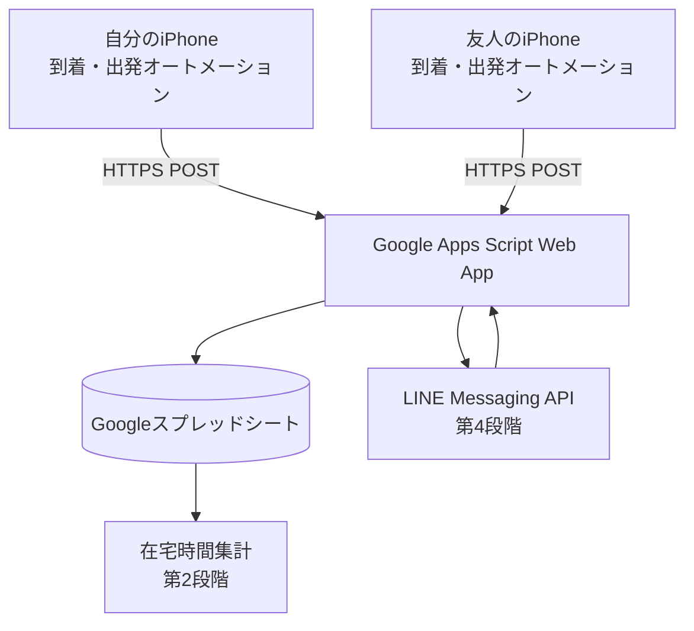

# 光熱費自動分担システム

2人のiPhoneで自宅への到着・出発を検知し、在宅時間の割合に応じて電気・ガス・水道などの請求額全体を分担するシステムです。

Repository: [mashushokunin/manage-elect](https://github.com/mashushokunin/manage-elect)

現在は第1段階として、iPhoneショートカットから受け取った `ENTER` / `EXIT` イベントをGoogle Apps Scriptで検証し、Googleスプレッドシートへ記録するところまで実装しています。

## システム構成



位置の座標や外出先は保存しません。保存対象は、自宅のジオフェンスに入った時刻と出た時刻だけです。

## 実装ロードマップ

1. **在宅イベント受信（実装済み）**
   - ユーザー別トークン認証
   - 入力値・日時の検証
   - イベントIDによる再送の重複防止
   - 連続した同種イベントや時系列逆転の要確認記録
   - 日本時間での保存
   - ユーザー、設定、在宅イベント、監査ログの初期化
2. **在宅時間集計・手動修正**
   - 指定期間の境界をまたぐ在宅時間の計算
   - 欠落区間を「判定不能」として分離
   - 修正履歴を残す手動補正
3. **請求管理・按分**
   - 電気・ガス・水道などの設定マスター
   - `個人の在宅時間 / 2人の在宅時間合計` による全額按分
   - ゼロ時間時の例外処理
   - 円単位の端数調整と合計金額の一致
4. **LINE Bot**
   - 請求項目・金額・対象期間の入力
   - 按分結果の返信
   - 計算履歴の保存
5. **運用仕上げ**
   - エラー通知、定期監査、バックアップ
   - 実測に基づくジオフェンス半径の調整
   - Gitリポジトリ化とリモートリポジトリ設定

請求元をタブ名で判定するのではなく、後続段階で「請求項目」設定表を追加し、LINE Botが有効な行を読み取る設計にします。利用者は行の追加・編集だけで請求元を変更できます。

## ディレクトリ構成

```text
manage-elect/
├── gas/
│   ├── Api.gs                 # Webアプリの入口
│   ├── Config.gs              # ID、シート名、既定値
│   ├── EventService.gs        # 認証・重複防止・イベント記録
│   ├── Setup.gs               # 初回シート作成と診断
│   ├── SpreadsheetStore.gs    # スプレッドシート操作
│   ├── Validation.gs          # リクエスト検証
│   └── appsscript.json        # Apps Scriptマニフェスト
├── tests/
│   └── validation.test.js
├── docs/
│   ├── requirements.md
│   └── stage1-deployment.md
├── .clasp.json                # 提供済みGAS Script ID
└── package.json
```

## ローカル検証

依存パッケージなしで検証できます。

```bash
npm test
```

デプロイとiPhoneショートカットの設定は [docs/stage1-deployment.md](docs/stage1-deployment.md) を参照してください。

## セキュリティ方針

- トークンはコードやスプレッドシートに保存せず、Apps Scriptのスクリプトプロパティに保存します。
- 受信ログにトークンや緯度・経度を残しません。
- ユーザーごとに別トークンを使います。
- Webアプリは匿名アクセスを許可する必要がありますが、すべての書き込みでトークンとユーザーの組み合わせを検証します。
- イベントの再送は同じイベントIDで冪等に処理します。
